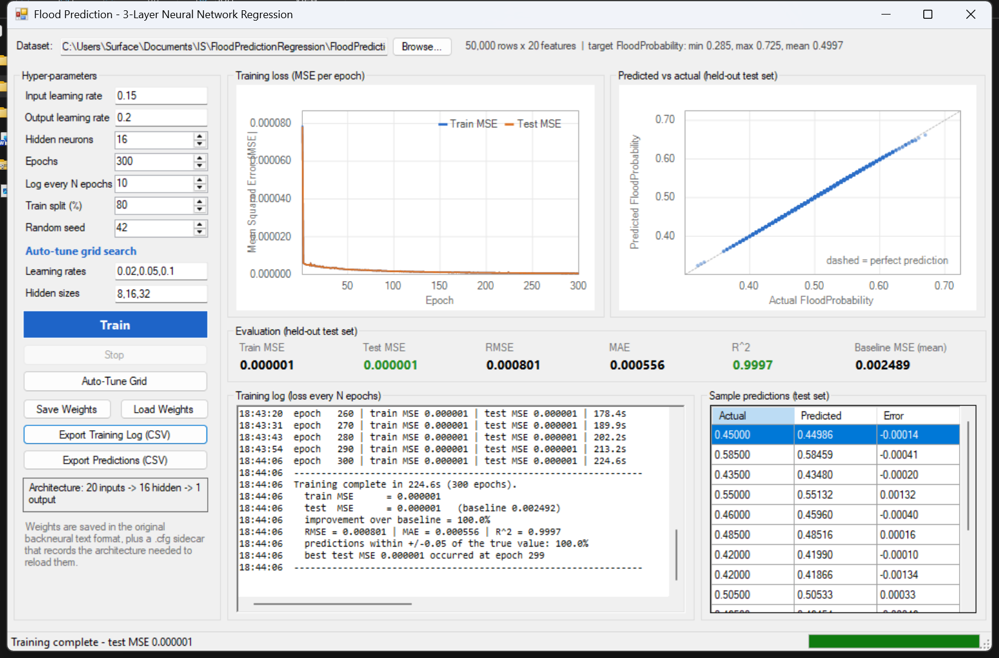
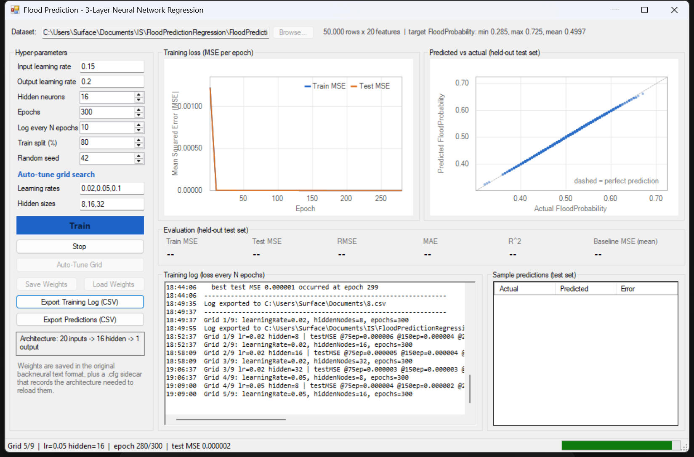
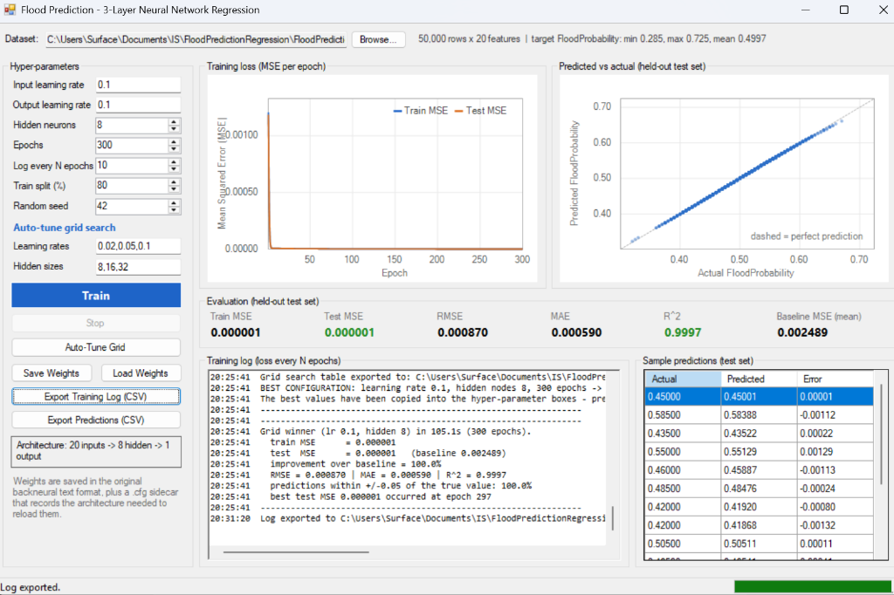

# Flood Prediction Regression — Neural Network in C# (WinForms)

A from-scratch multilayer perceptron (MLP) trained with back-propagation to predict the
**FloodProbability** of a region from 20 environmental / socio-political indicators.
Everything — CSV parsing, Min-Max scaling, the network itself, the training loop, the loss
charts and the grid search — is written by hand in C#. **No machine-learning library is used**;
the network is built only from the `backneural` classes supplied with the activity
(`INeuron`, `HNeuron`, `ONeuron`, `NeuralNet` in the `Backprop` namespace).

---

## 1. Is the activity feasible as specified?

Verified against the supplied `Instruction.png`, `About Dataset.docx` and `Sample Code\*.cs`:

| Item in the instructions | Verdict | Notes |
|---|---|---|
| Regression (not classification) with a neural network | ✅ Appropriate | The target `FloodProbability` is a continuous value in `[0.285, 0.725]`; a single sigmoid output node with MSE loss models it directly. |
| Use the supplied `backneural` classes | ✅ Kept | Class names, namespaces and the back-propagation math are unchanged; only additive extensions were made (see §8). |
| Feed-forward + back-prop correctness | ✅ Verified | Hidden-layer deltas are computed with the **pre-update** output weights (the classic ordering), bias included, learning rates applied per layer. |
| Data preprocessing from a CSV | ✅ Done | Hand-written CSV reader, Min-Max scaler, seeded shuffle + 80/20 split. |
| Hyper-parameter tuning (learning rate, hidden nodes, epochs) | ✅ Done | Manual controls **and** an automatic grid search (§6). |
| Evaluation metrics for regression | ✅ Done | MSE, RMSE, MAE, R² plus a predict-the-mean baseline (§7). |
| Watch training progress (WinForms GUI) | ✅ Done | Live loss curve, predicted-vs-actual scatter, metric tiles, log pane (§5). |

One correction was made to the supplied sample code: the scaler statistics are fitted on the
**training split only** (fitting on all 50,000 rows would leak test information into training).
See §8.

---

## 2. Data

**File:** `FloodPredictionDataSet\flood.csv` — 50,000 rows × 21 columns (20 features + 1 target).

| | |
|---|---|
| Target column | `FloodProbability` (float, range **0.285 – 0.725**, mean **0.4997**, std **0.05003**) |
| Feature type | Mostly small non-negative integers (ordinal scores, roughly 0–15) |
| Missing values | none (`warning=none` from the loader) |
| Other files in the zip | `train.csv` / `test.csv` / `sample_submission.csv` — the Kaggle competition split. We use `flood.csv` because it contains the target for all 50,000 rows, so we can hold out a proper test set. |

**Features (in file order):**

`MonsoonIntensity`, `TopographyDrainage`, `RiverManagement`, `Deforestation`, `Urbanization`,
`ClimateChange`, `DamsQuality`, `Siltation`, `AgriculturalPractices`, `Encroachments`,
`IneffectiveDisasterPreparedness`, `DrainageSystems`, `CoastalVulnerability`, `Landslides`,
`Watersheds`, `DeterioratingInfrastructure`, `PopulationScore`, `WetlandLoss`,
`InadequatePlanning`, `PoliticalFactors`.

Each is an index describing how strongly that factor worsens flood risk; the target is the
modelled flood probability for the same region.

**Baseline to beat (predict-the-mean test MSE) = `0.002489`.**
Any useful network must score well below that number.

---

## 3. Preprocessing

1. **Parse** — `Data\FloodDataset.cs` reads the CSV header, converts every cell with
   `double.TryParse` (culture-invariant) and keeps the raw feature matrix separate from the
   scaled one.
2. **Split** — seeded Fisher–Yates shuffle, then **80 % train / 20 % test = 40,000 / 10,000**
   (default seed **42**). The split is done *before* any statistics are computed.
3. **Scale** — `Data\MinMaxScaler.cs` maps every feature to `[0,1]` with
   `x' = (x − min) / (max − min)`, where `min`/`max` are taken **from the training split only**
   (test values are transformed with those same statistics, so no test information leaks in).
4. **Target** — passed through unchanged: it is already a probability in `[0,1]`, which is
   exactly the range of the sigmoid output node. Scaling it again would be redundant.

The GUI shows the resulting range so the scaling can be verified visually.

---

## 4. Model and back-propagation

```
inputs (20)  →  hidden layer (H sigmoid nodes)  →  output (1 sigmoid node)
```

Forward pass per pattern:

```
h_j = σ( Σ_i w_ij · x_i + b_j )        σ(z) = 1 / (1 + e^(−z))
y   = σ( Σ_j v_j · h_j + c )
```

Loss (the training objective, one epoch = every pattern once, online SGD in shuffled order):

```
MSE = (1/N) Σ (t − ŷ)²
```

Back-propagation (the sample's `Backprop` math, kept as-is):

```
δ_out   = ŷ · (1 − ŷ) · (t − ŷ)                  // sigmoid derivative × error
δ_h,j   = h_j · (1 − h_j) · Σ_k v_k · δ_out,k    // uses the PRE-update output weights
v_k    += LR_out · δ_out,k · h_j     and   c += LR_out · δ_out,k
w_ij   += LR_in  · δ_h,j · x_i       and   b_j += LR_in  · δ_h,j
```

Two learning rates exist because the sample defined them as constants
(`LRPIN = 0.15`, `LRPOUT = 0.2`); here they are settable properties so they can be tuned.

---

## 5. The GUI (`Form1`)

| Region | What it shows / does |
|---|---|
| Dataset bar | Auto-discovers `flood.csv` (walks up from the exe); **Browse…** to pick another file; row/feature/target info |
| Hyper-parameters | Input LR, output LR, hidden nodes, epochs, log-every-N, train split %, seed — all editable |
| Auto-tune grid | Comma-separated LR list and hidden-size list → **Auto-Tune Grid** runs every combination |
| Buttons | Train, Stop, Auto-Tune Grid, Save/Load Weights, Export Training Log (CSV), Export Predictions (CSV) |
| Loss chart | GDI+ line chart of MSE vs epoch, redrawn live |
| Scatter chart | GDI+ predicted-vs-actual plot of the held-out test set (perfect prediction = 45° line) |
| Metric tiles | Train MSE, Test MSE, RMSE, MAE, R², Baseline MSE |
| Log pane | Run header, loss every N epochs, grid-search table |
| Sample predictions | First test rows: actual vs predicted vs absolute error |
| Status bar | Phase + progress (`Epoch 123/300`, `Grid 4/9 …`) |

**Charts are hand-painted with GDI+** (`Controls\ChartPainter.cs`, `LossCurveChart.cs`,
`PredictionScatterChart.cs`) — no chart control or third-party library.

**After a completed run** — loss curve, metric tiles (green = beats the baseline), the
predicted-vs-actual scatter hugging the dashed 45° line, and the per-row sample table:



**During an Auto-Tune sweep** — the status bar shows which cell is running, the epoch counter
and the live test MSE, with a progress bar:



**After an Auto-Tune sweep** — the best configuration (LR = 0.1, Hidden = 8, 300 epochs) is
automatically selected and populated into the hyperparameter inputs, while its evaluation metrics,
45° scatter plot, and predictions are updated:



---

## 6. Hyper-parameter tuning

### Manual
Edit the fields and press **Train**. Changing any field updates the architecture label and
invalidates the previously trained weights.

### Automatic grid search (**Auto-Tune Grid**)
Default grid: learning rates `{0.02, 0.05, 0.1}` × hidden sizes `{8, 16, 32}` = **9 configurations**,
each trained for the epoch budget in **Epochs** (default 300). Test MSE is sampled at four
even checkpoints across the budget — **75 / 150 / 225 / 300** for a 300-epoch run — so one sweep
answers three questions at once:
*which learning rate, how many hidden nodes, and how many epochs are enough.*

The results are ranked by final test MSE, printed as a table in the log and exported to
`bin\Debug\hyperparameter_results_<timestamp>.csv` as well as archived in
[`results/hyperparameter_tuning_results.csv`](results/hyperparameter_tuning_results.csv)
(columns: `Rank, LearningRate, HiddenNodes, Epochs, TestMSE@75ep…, FinalTestMSE, FinalTrainMSE, RMSE, MAE, R2, BaselineTestMSE`).
The best configuration is then copied back into the manual fields, and its full metrics,
scatter plot and sample predictions are shown in the evaluation pane.

**Official GUI Auto-Tune Results (`results/hyperparameter_tuning_results.csv`)**
*(9 configurations × 300 epochs, seed 42, 40k train / 10k test, baseline test MSE = 0.002489)*:

| Rank | Learning Rate | Hidden Nodes | Test MSE @75 ep | Test MSE @150 ep | Test MSE @225 ep | Test MSE @300 ep | Final Test RMSE | Final Test MAE | Final Test R² |
|-----:|--------------:|-------------:|----------------:|-----------------:|-----------------:|-----------------:|----------------:|---------------:|--------------:|
| **1** | **0.10** | **8**  | 0.0000024 | 0.0000014 | 0.0000010 | **0.00000076** | **0.000870** | **0.000590** | **0.999696** |
| 2 | 0.10 | 16 | 0.0000028 | 0.0000018 | 0.0000013 | 0.00000099 | 0.000998 | 0.000706 | 0.999600 |
| 3 | 0.10 | 32 | 0.0000022 | 0.0000016 | 0.0000014 | 0.00000106 | 0.001030 | 0.000741 | 0.999574 |
| 4 | 0.05 | 8  | 0.0000039 | 0.0000024 | 0.0000018 | 0.00000138 | 0.001174 | 0.000818 | 0.999446 |
| 5 | 0.05 | 32 | 0.0000027 | 0.0000022 | 0.0000019 | 0.00000164 | 0.001282 | 0.000955 | 0.999340 |
| 6 | 0.05 | 16 | 0.0000038 | 0.0000028 | 0.0000022 | 0.00000179 | 0.001338 | 0.000973 | 0.999281 |
| 7 | 0.02 | 32 | 0.0000031 | 0.0000028 | 0.0000026 | 0.00000243 | 0.001559 | 0.001183 | 0.999023 |
| 8 | 0.02 | 8  | 0.0000061 | 0.0000045 | 0.0000035 | 0.00000286 | 0.001691 | 0.001210 | 0.998851 |
| 9 | 0.02 | 16 | 0.0000048 | 0.0000041 | 0.0000036 | 0.00000315 | 0.001775 | 0.001311 | 0.998734 |

*(Baseline test MSE = `0.002489`. All configurations achieve a >99.8% reduction in MSE over baseline.)*

**Headless CLI Grid Search Validation (`grid_results.txt`)**
*(Sampled at 50 / 100 / 200 / 300 epochs)*:

| Rank | Learning Rate | Hidden Nodes | MSE @50 ep | MSE @100 ep | MSE @200 ep | MSE @300 ep | R² @300 ep |
|-----:|--------------:|-------------:|-----------:|-----------:|-----------:|-----------:|-----------:|
| 1 | **0.10** | **8**  | 0.000003 | 0.000002 | 0.000001 | **0.000001** | **0.9997** |
| 2 | 0.10 | 16 | 0.000003 | 0.000002 | 0.000001 | 0.000001 | 0.9996 |
| 3 | 0.10 | 32 | 0.000003 | 0.000002 | 0.000001 | 0.000001 | 0.9996 |
| 4 | 0.05 | 8  | 0.000005 | 0.000003 | 0.000002 | 0.000001 | 0.9994 |
| 5 | 0.05 | 32 | 0.000003 | 0.000003 | 0.000002 | 0.000002 | 0.9993 |
| 6 | 0.05 | 16 | 0.000004 | 0.000003 | 0.000002 | 0.000002 | 0.9993 |
| 7 | 0.02 | 32 | 0.000003 | 0.000003 | 0.000003 | 0.000002 | 0.9990 |
| 8 | 0.02 | 8  | 0.000007 | 0.000006 | 0.000004 | 0.000003 | 0.9989 |
| 9 | 0.02 | 16 | 0.000005 | 0.000005 | 0.000004 | 0.000003 | 0.9987 |

*(MSE values are printed to 6 decimals; R² is given to 4 decimals and is the column that
separates the close cases.)*

**Analysis**

* **Every configuration beats the baseline by ~3 orders of magnitude** (0.002489 → 0.000001…0.000003),
  so the network is genuinely learning the relationship, not just the mean.
* **Learning rate is the dominant hyper-parameter.** 0.10 > 0.05 > 0.02 at every checkpoint.
  With `lr = 0.02` the network is still improving at epoch 300 (its curve has not flattened),
  which is the classic signature of a learning rate that is too small.
* **Hidden width matters little.** 8, 16 and 32 hidden nodes land within ~2× of each other and
  8 nodes even ranked first — the target is close to a smooth low-dimensional function, so extra
  capacity buys nothing. **Smaller is better here: same accuracy, ~4× fewer weights to train.**
* **Epochs: strong diminishing returns.** Most of the gain happens in the first ~100 epochs; from
  100 → 300 the MSE drops by roughly 2× while the cost triples. 200–300 epochs is a sensible
  budget; below ~50 the model is still far from converged.
* The default manual configuration (separate rates `LR_in = 0.15` / `LR_out = 0.2`, 16 hidden,
  300 epochs) independently reached **test MSE 0.000001, RMSE 0.000801, MAE 0.000556,
  R² 0.9997** — consistent with the grid's best cell.

**Recommended setting: `learning rate = 0.1`, `hidden nodes = 8`, `epochs ≥ 200`.**
The GUI's **Auto-Tune Grid** button runs this sweep automatically and copies the winner back
into the manual fields.

---

## 7. Evaluation

All metrics are computed on the **held-out 20 % test set** (`Training\Metrics.cs`):

| Metric | Formula | Meaning |
|---|---|---|
| **MSE** | `mean((t − ŷ)²)` | Primary loss; lower is better |
| **RMSE** | `√MSE` | Error in the same units as the target (probability points) |
| **MAE** | `mean(|t − ŷ|)` | Typical absolute miss |
| **R²** | `1 − SS_res / SS_tot` | Variance explained; 1.0 = perfect, 0 = no better than the mean |
| **Baseline MSE** | `mean((t − mean_train)²)` | Score of the "always predict the mean" model |

**How to read the results.** The baseline is `0.002489`, i.e. a model that ignores the inputs and
predicts the average flood probability. A well-trained network reaches a test MSE on the order of
`0.000001` — roughly **three orders of magnitude** better — with `R² ≈ 0.999`, meaning it explains
almost all of the variance in flood probability. RMSE ≈ `0.0008` says a typical prediction is off
by less than 0.1 probability points, which is small compared with the target's own spread
(σ = 0.05).

---

## 8. Deviations from the supplied sample code

The four `backneural` files were kept — same namespace (`Backprop`), same class names, same
forward/back-prop formulas — with these **additive** changes:

| Change | Why |
|---|---|
| `LRPIN` / `LRPOUT` changed from `const` to settable properties | The activity requires tuning the learning rate |
| Added `SeedRandom(int)` / `seedWeights(int)` | Reproducible runs (same seed ⇒ identical weights and metrics) |
| Added `Forward(double[])` and `ComputeSquaredError()` | Clean evaluation of a pattern without mutating weights |
| `sigmoid()` made overflow-safe (`z < −700` guard) | `e^(−z)` could overflow for large negative inputs |
| Removed `countgood()` | It counted "good" outputs with a classification threshold — meaningless for a continuous regression target; replaced by MSE/RMSE/MAE/R² |
| Scaler fitted on the training split only | The naive "scale everything" approach leaks test statistics into training |
| Added `Training\`, `Data\`, `Controls\` folders and the whole WinForms layer | Training loop, metrics, grid search, CSV I/O and charts did not exist in the sample |

---

## 9. Build and run

**Visual Studio** — open `FloodPrediction\FloodPrediction.slnx`, press **F5**.

**Command line**

```powershell
& "C:\Program Files\Microsoft Visual Studio\18\Community\MSBuild\Current\Bin\MSBuild.exe" `
    "FloodPrediction\FloodPrediction\FloodPrediction.csproj" /p:Configuration=Debug /v:minimal /nologo
```

Then run `FloodPrediction\FloodPrediction\bin\Debug\FloodPrediction.exe`.

Requirements: .NET Framework 4.7.2 (C# 7.3), Windows. No NuGet packages.

**Handing it in (GitHub)** — the project is a plain folder, so from the project root:

```powershell
cd "C:\Users\Surface\Documents\IS\FloodPredictionRegression"
git init
git add .
git commit -m "Flood prediction regression - 3-layer MLP with back-propagation in C#"
git remote add origin <your-repository-url>
git push -u origin main
```

A `.gitignore` is included so build output and exported run artifacts stay out of the repo.

**Typical session**

1. The app finds `flood.csv` automatically (or use **Browse…**) — the dataset profile appears.
2. Keep the defaults (LR in `0.15` / out `0.2`, 16 hidden, 300 epochs, split 80 %, seed 42) and press **Train**.
   The loss curve drops within the first few epochs; metrics fill in at the end.
3. Press **Auto-Tune Grid** to sweep the 9-configuration grid; the ranked table is logged and
   written to `bin\Debug\hyperparameter_results_*.csv`.
4. **Export Training Log** — saving as **`.csv`** writes one row per epoch
   (`Epoch,TrainMSE,TestMSE,ElapsedSeconds`), the loss history ready for a spreadsheet;
   saving as **`.txt`** writes the full console log (run header, loss every N epochs, summary).
   **Export Predictions (CSV)** writes actual/predicted/error rows of the test set;
   **Save Weights** stores the network in the original `backneural` text format plus a `.cfg`
   sidecar describing the architecture, so **Load Weights** can restore it exactly.

---

## 10. Project structure

```
FloodPredictionRegression\
├─ README.md                        ← this file
├─ screenshots\                     ← GUI screenshots used in this document
├─ results\                         ← evaluation deliverables for grading / report
│  ├─ hyperparameter_tuning_results.csv ← 9-config grid search results table (CSV)
│  ├─ training_console_log.txt      ← full console training and autotune history (TXT)
│  └─ grid_search_harness.txt       ← headless test harness validation run (TXT)
├─ Instruction.png                  ← activity instructions (supplied)
├─ About Dataset.docx               ← dataset description (supplied)
├─ Sample Code\*.cs                 ← original backneural sample (supplied)
├─ FloodPredictionDataSet\          ← flood.csv + Kaggle train/test/sample_submission
└─ FloodPrediction\
   └─ FloodPrediction\
      ├─ Program.cs                 entry point
      ├─ Form1.cs                   GUI logic: training, grid search, logging, exports
      ├─ Form1.Designer.cs          hand-written layout
      ├─ Backprop\                  ← the supplied backneural classes (extended, §8)
      │  ├─ INeuron.cs  HNeuron.cs  ONeuron.cs  NeuralNet.cs
      ├─ Data\
      │  ├─ FloodDataset.cs         CSV reader, raw/scaled matrices, seeded split
      │  └─ MinMaxScaler.cs         [0,1] scaling fitted on the train split
      ├─ Training\
      │  ├─ TrainingEngine.cs       epoch loop, evaluation, prediction
      │  ├─ HyperParameterTuner.cs  grid search + checkpoint sampling
      │  └─ Metrics.cs              MSE / RMSE / MAE / R² / baseline
      └─ Controls\
         ├─ ChartPainter.cs         shared GDI+ drawing helpers
         ├─ LossCurveChart.cs       live loss curve
         └─ PredictionScatterChart.cs  predicted-vs-actual scatter
```

---

## 11. Reproducibility

* Every run is seeded (split shuffle **and** weight init), so the same settings always give the
  same loss curve and the same metrics.
* The per-epoch training log (loss every N epochs) can be exported to CSV for plotting in a
  spreadsheet.
* A headless test harness was used during development to verify, without the GUI, that:
  the training loss falls and keeps falling, the network beats the baseline by orders of
  magnitude, a run with the same seed reproduces bit-for-bit, a perfect prediction gives
  MSE = 0 / R² = 1, and the scaled features really lie in `[0,1]`.
